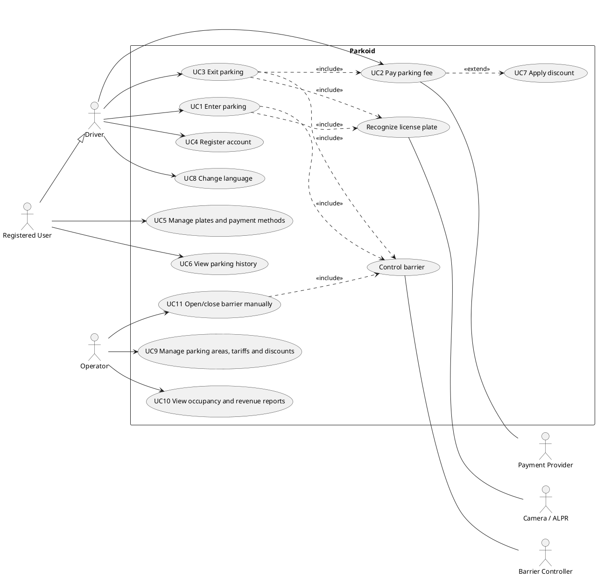
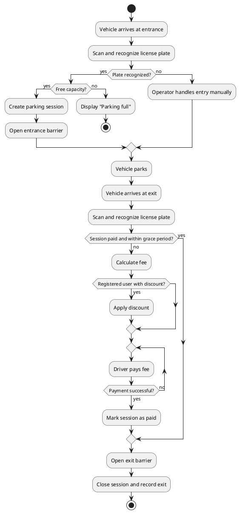
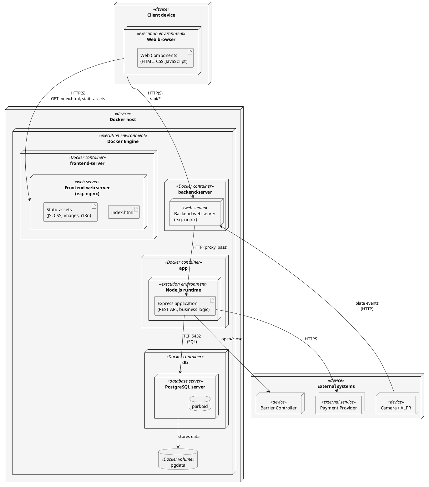

# 1. Software requirement specification

## A. Goals

Parkoid is a software system for managing parking areas. It automates vehicle access, fee calculation and payment, and gives operators a clear view of how their parking facilities are used. The goal is to replace manual ticketing and cash handling with a fast, reliable and contactless experience for both drivers and operators.

**Main goals**

- **Automated vehicle identification.** Parkoid scans license plates at the entrance and exit using cameras and recognizes the plate automatically, so drivers do not need paper tickets or cards.
- **Barrier control.** Based on the recognition result and the vehicle's status (registered, paid, within a permitted grace period), the system opens or keeps closed the parking barriers at the entrance and exit. Operators can also open them manually in exceptional cases.
- **Payment processing.** The system calculates the parking fee from the time spent in the facility and the applicable tariff, and supports electronic payment so that a vehicle can leave without delay once the fee is settled.
- **User accounts and discounts.** Drivers can create an account in the application, link their license plates and payment methods, and review their parking history. Registered users receive various discounts, such as loyalty, frequent-visitor or promotional rates, which encourages registration and repeat use.
- **Multilingual support.** The application is available in multiple languages, so that local residents and international visitors can use it without difficulty. The architecture must allow new languages to be added easily.

**Benefits**

For drivers, Parkoid shortens waiting times at the barriers, removes the need to carry tickets, and makes prices and discounts transparent. For operators, it reduces staff costs and payment errors, improves security through a full record of entries and exits, and provides data on occupancy and revenue to support decisions about pricing and capacity.

**Scope and expectations**

The system covers the whole parking cycle: entry, stay, payment and exit, together with account management and administration of tariffs, discounts and parking areas. It should be reliable, secure and easy to use. Personal data such as license plates and payment details must be protected in line with applicable privacy regulations. Detailed requirements are described in the following sections.

## B. Functional and Non-functional requirements
### Functional requirements

**License plate recognition**
- FR-1: The system shall scan and recognize vehicle license plates at the entrance and exit using cameras.
- FR-2: The system shall record every entry and exit (plate, timestamp, parking area) as a full history.

**Barrier control**
- FR-3: The system shall open the entrance barrier for a recognized vehicle that is allowed to enter.
- FR-4: The system shall open the exit barrier for a vehicle whose fee is paid or that is within the permitted grace period, and keep it closed otherwise.
- FR-5: Operators shall be able to open and close barriers manually in exceptional cases.

**Payment**
- FR-6: The system shall calculate the parking fee from the time spent in the facility and the applicable tariff.
- FR-7: The system shall support electronic payment of the parking fee.
- FR-8: The system shall allow a vehicle to leave once the fee is settled, without further action by the driver.

**User accounts and discounts**
- FR-9: Drivers shall be able to create and manage an account in the application.
- FR-10: Users shall be able to link license plates and payment methods to their account.
- FR-11: Users shall be able to review their parking history and payments.
- FR-12: The system shall apply discounts (e.g. loyalty, frequent-visitor, promotional) automatically to registered users.

**Administration**
- FR-13: Operators shall be able to manage parking areas, tariffs and discounts.
- FR-14: The system shall provide operators with occupancy and revenue data.

**Localization**
- FR-15: The application shall be available in multiple languages and let users choose their language.

### Non-functional requirement

- NFR-1 **Usability:** The application shall be simple and intuitive for drivers, and prices and discounts shall be displayed transparently.
- NFR-2 **Performance:** Plate recognition and barrier opening shall be fast enough to avoid noticeable waiting or queues at the barriers.
- NFR-3 **Reliability and availability:** The system shall operate continuously and handle failures (e.g. unreadable plate, network outage) gracefully, with a manual fallback.
- NFR-4 **Security:** Payment and personal data shall be transmitted and stored securely, with authentication and role-based access for users and operators.
- NFR-5 **Privacy:** Processing of license plates and payment details shall comply with applicable privacy regulations (e.g. GDPR).
- NFR-6 **Accuracy:** Fee calculation and payment records shall be correct and auditable.
- NFR-7 **Extensibility and localization:** The architecture shall allow new languages, tariffs, and parking areas to be added easily without code redesign.
- NFR-8 **Scalability:** The system shall support multiple parking areas and a growing number of users.

## C. Use cases

### Actors

- **Driver** – a person parking a vehicle (may be anonymous or a registered user).
- **Registered User** – a driver with an account (specialization of Driver).
- **Operator** – parking staff/administrator.
- **Payment Provider** – external payment system.
- **Camera / ALPR** – external license plate recognition system.
- **Barrier Controller** – external hardware that opens and closes the barriers.

### Use case diagram (UML, PlantUML)

### Use case scenarios

#### UC1 Enter parking
- **Actors:** Driver, Camera / ALPR, Barrier Controller
- **Precondition:** The parking area has free capacity; the barrier is closed.
- **Main scenario:**
  1. The vehicle stops at the entrance barrier.
  2. The camera scans the license plate and the system recognizes it.
  3. The system creates a parking session (plate, timestamp, area).
  4. The system opens the barrier; the vehicle enters and the barrier closes.
- **Alternative scenarios:**
  - 2a. Plate not readable: the system retries; if it still fails, the driver is directed to the operator (UC11).
  - 2b. Parking full: the barrier stays closed and a message is displayed.
  - 2c. Plate already has an active session: the system rejects entry and notifies the operator.
- **Postcondition:** An active session exists for the plate.

#### UC2 Pay parking fee
- **Actors:** Driver, Payment Provider
- **Precondition:** The vehicle has an active parking session.
- **Main scenario:**
  1. The driver enters the plate (or selects it in the app).
  2. The system calculates the fee from the duration and tariff.
  3. If the user is registered, a discount is applied (UC7).
  4. The driver chooses a payment method and confirms.
  5. The Payment Provider authorizes the payment.
  6. The system marks the session as paid and records the payment.
- **Alternative scenarios:**
  - 5a. Payment declined: the system shows the reason and allows another method.
  - 1a. No session found for the plate: the system informs the driver.
- **Postcondition:** The session is paid and the exit is allowed for the grace period.

#### UC3 Exit parking
- **Actors:** Driver, Camera / ALPR, Barrier Controller
- **Precondition:** The vehicle has an active session.
- **Main scenario:**
  1. The vehicle stops at the exit barrier and the plate is recognized.
  2. The system checks that the session is paid and within the grace period.
  3. The system opens the barrier; the vehicle leaves.
  4. The system closes the session and records the exit time.
- **Alternative scenarios:**
  - 2a. Not paid or grace period expired: the system calculates the remaining fee and requests payment (UC2); the barrier stays closed until paid.
  - 1a. Plate not readable: the driver is directed to the operator (UC11).
- **Postcondition:** The session is closed and the vehicle has left.

#### UC4 Register account
- **Actors:** Driver
- **Precondition:** The driver has no account.
- **Main scenario:**
  1. The driver opens the registration form and enters e-mail, password and name.
  2. The system validates the data and checks that the e-mail is unique.
  3. The system sends a confirmation e-mail; the driver confirms it.
  4. The account is activated.
- **Alternative scenarios:**
  - 2a. Invalid data or e-mail already used: the system shows an error.
  - 3a. Confirmation link expired: the system resends it.
- **Postcondition:** A registered user account exists.

#### UC5 Manage plates and payment methods
- **Actors:** Registered User
- **Precondition:** The user is logged in.
- **Main scenario:**
  1. The user opens the profile settings.
  2. The user adds, edits or removes a license plate or payment method.
  3. The system validates and saves the change.
- **Alternative scenarios:**
  - 3a. Plate already linked to another account: the system rejects the change.
  - 3b. Payment method rejected by the provider: the system shows an error.
- **Postcondition:** The profile is updated.

#### UC6 View parking history
- **Actors:** Registered User
- **Precondition:** The user is logged in.
- **Main scenario:**
  1. The user opens the history section.
  2. The system lists past sessions with dates, area, duration, fee and applied discount.
  3. The user can open a session for details.
- **Alternative scenario:** 2a. No sessions yet: an empty-state message is shown.

#### UC7 Apply discount (extends UC2)
- **Actors:** System
- **Precondition:** The fee is calculated and the plate belongs to a registered user.
- **Main scenario:**
  1. The system finds the discounts the user is eligible for (loyalty, frequent visitor, promotion).
  2. The system selects the most favorable applicable discount.
  3. The fee is reduced and the discount is shown to the driver.
- **Alternative scenario:** 1a. No eligible discount: the full fee is charged.

#### UC8 Change language
- **Actors:** Driver
- **Main scenario:**
  1. The driver opens the language selection.
  2. The driver selects a language.
  3. The application displays all texts in that language and remembers the choice.
- **Alternative scenario:** 3a. A text is not translated: the default language is used.

#### UC9 Manage parking areas, tariffs and discounts
- **Actors:** Operator
- **Precondition:** The operator is logged in with an administrator role.
- **Main scenario:**
  1. The operator selects an area, tariff or discount to manage.
  2. The operator creates, edits or deactivates it.
  3. The system validates and saves the change; it applies to new sessions.
- **Alternative scenario:** 3a. Invalid or overlapping tariff periods: the system rejects the change.

#### UC10 View occupancy and revenue reports
- **Actors:** Operator
- **Main scenario:**
  1. The operator selects an area and a period.
  2. The system displays occupancy, number of sessions and revenue.
  3. The operator may export the report.
- **Alternative scenario:** 2a. No data for the period: an empty report is shown.

#### UC11 Open/close barrier manually
- **Actors:** Operator, Barrier Controller
- **Precondition:** The operator is logged in.
- **Main scenario:**
  1. The operator selects a barrier and the action (open/close).
  2. The system sends the command to the Barrier Controller.
  3. The barrier moves and the system logs the action with the operator and reason.
- **Alternative scenario:** 3a. Controller not responding: the system shows an error and notifies the operator.

### Business process (UML activity diagram)

The most complex process is the vehicle's full stay cycle (UC1, UC2, UC3, UC7).

The other use cases are simple, single-actor flows and are fully described by their scenarios, so they need no separate activity diagram.

# 2. Architecture & Design

## A. Architecture

**Architectural decision.** Parkoid is split into a frontend and a backend, each with its own web server.

- **Frontend:** plain HTML, CSS and JavaScript without a framework. UI components are implemented as Web Components (custom elements). The frontend is a set of static files (`index.html`, scripts, styles, images, translations) served by the *frontend web server*.
- **Backend:** Node.js with the Express framework and a PostgreSQL database. The *backend web server* acts as a reverse proxy in front of the Node.js (Express) application, which exposes the API.
- **Platform:** every node runs as a Docker container, and the whole system is orchestrated with Docker Compose.
- A CDN is not part of the architecture; it may be introduced later in the deployment phase.

### Deployment diagram (UML, PlantUML)

**Nodes and responsibilities**

| Node | Technology | Responsibility |
|------|------------|----------------|
| Web browser | HTML, CSS, JavaScript, Web Components | Renders the UI and calls the API. |
| frontend-server | Web server in Docker | Serves `index.html` and static frontend assets. |
| backend-server | Web server in Docker | Reverse proxy; forwards API requests to the Node.js application. |
| app | Node.js, Express in Docker | REST API and application logic. |
| db | PostgreSQL in Docker | Persistent storage; data kept in a Docker volume. |
## B. UI & UX

## C. Data layer

## D. API

## E. Application logic
    
